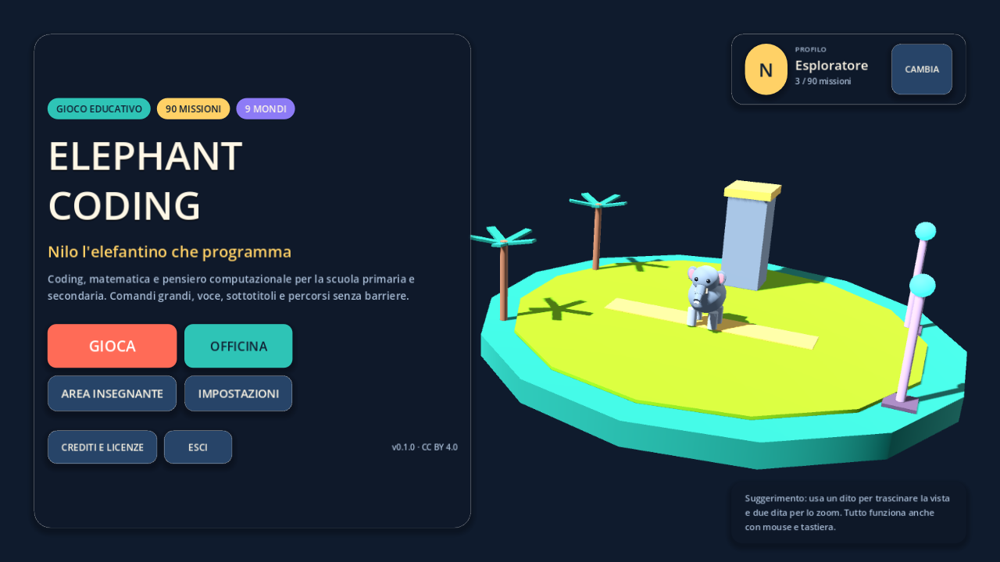
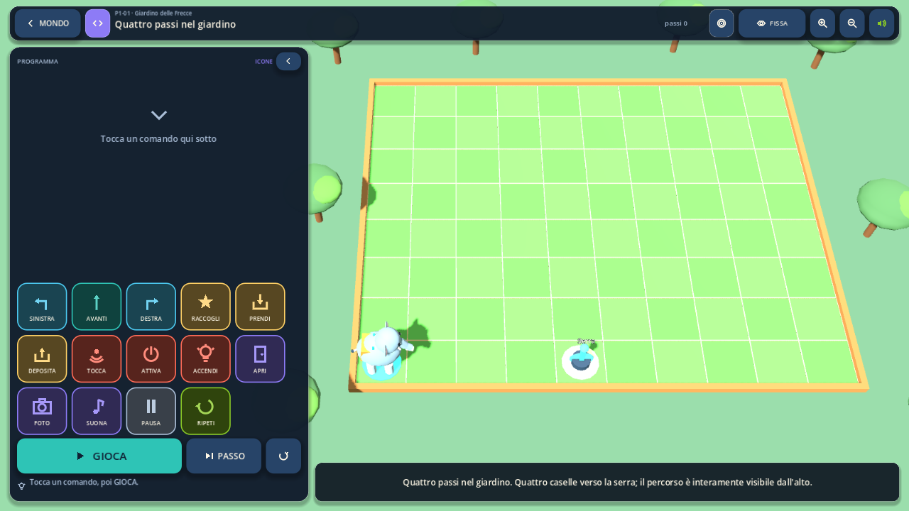
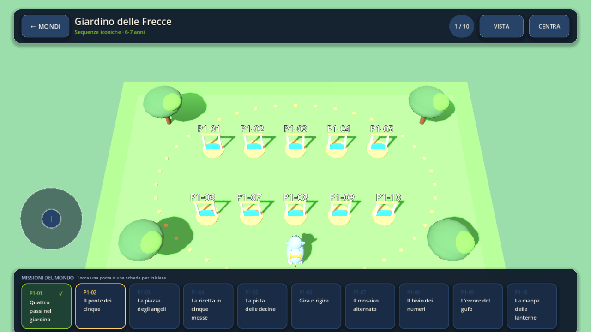

# ElephantCoding

**Nilo l'elefantino che programma** — un gioco educativo 3D per imparare il
pensiero computazionale, la logica e la matematica dalla scuola dell'infanzia
alla secondaria di primo grado.

90 missioni · 9 mondi · comandi grafici per il touch · tre viste 3D ·
sottotitoli sempre disponibili · area insegnante · nessun account



## Che cos'è

ElephantCoding è un progetto Godot 4 open source. Ogni mondo introduce un
linguaggio di programmazione via via più formale:

| Codice | Mondo | Età | Linguaggio |
| --- | --- | --- | --- |
| INF | Savana delle Impronte | 4-6 | Pittogrammi e direzioni |
| P1 | Giardino delle Frecce | 6-7 | Sequenze iconiche |
| P2 | Officina dei Fili | 7-8 | Stringhe analogiche e perle |
| P3 | Borgo dei Comandi | 8-9 | Testo italiano, `RIPETI` |
| P4 | Isola Cartesiana | 9-10 | Coordinate e piano XY |
| P5 | Centro di Ricerca | 10-11 | Variabili, `SE`, `FINCHÉ` |
| S1 | Cittadella delle Funzioni | 11-12 | Funzioni e parametri |
| S2 | Arcipelago degli Algoritmi | 12-13 | Liste, matrici, dati |
| S3 | Metropoli dei Sistemi | 13-14 | Stati, eventi, grafi |

Il programma scritto dal giocatore viene eseguito da un simulatore
deterministico, separato dal renderer. La stessa sequenza di istruzioni produce
sempre gli stessi eventi, quindi il replay passo-passo, i test automatici e la
diagnostica mostrano esattamente ciò che accade.



## Requisiti

- **Godot 4.7.2 stable** (o una 4.7.x compatibile), renderer Compatibility.
- macOS, Windows, Linux, Android o un browser con WebGL 2 per la build web.
- Nessuna dipendenza esterna per il gioco. I tool Python usano solo la
  standard library.

## Avvio

```bash
# dalla radice del repository
godot --path godot

# oppure: apri la cartella godot/ nell'editor e premi F5
```

Il progetto parte dalla scena `godot/scenes/main.tscn`. La risoluzione di
progetto è 1600×900, ridimensionabile; il layout è pensato per touch screen e
lavagne interattive.

## Distribuzioni

Le build per macOS, Windows, Linux, Android (sideload) e web si generano con:

```bash
./tools/dist/build_distributions.sh
```

Gli artefatti finiscono in `dist/`: DMG e ZIP per macOS, installer NSIS e ZIP
portatile per Windows, `.deb` e `.tar.gz` per Linux, APK per Android, ZIP per
il web, più `SHA256SUMS.txt`. Istruzioni, requisiti e limiti in
[`docs/DISTRIBUTION.md`](docs/DISTRIBUTION.md).

Le build verificate di questa versione sono pubblicate nella
[release v0.1.1](https://github.com/MaestroLivio/ElephantCoding/releases/tag/v0.1.1).

Gli artefatti non hanno una firma commerciale, quindi al primo avvio il sistema
può bloccarli: su macOS si sbloccano da *Impostazioni di Sistema → Privacy e
Sicurezza → Apri comunque* (il DMG contiene un `LEGGIMI.txt` con i passi), su
Windows da *Ulteriori informazioni → Esegui comunque*. Dettagli e pipeline di
notarizzazione in [`docs/DISTRIBUTION.md`](docs/DISTRIBUTION.md).

## Comandi

| Azione | Touch | Mouse / tastiera |
| --- | --- | --- |
| Muovere Nilo nel mondo | joystick virtuale | `WASD` / frecce (dove previsto) |
| Eseguire il programma | `ESEGUI` | `F5` |
| Passo singolo | `PASSO` | `F6` |
| Reset | `RESET` | `F7` |
| Cambiare vista 3D | `VISTA` | `1` / `2` / `3` |
| Ruotare la vista | trascinare con un dito | trascinare con il mouse |
| Zoom | pizzicare con due dita | rotella |
| Torna al mondo | `← MONDO` | `Esc` |
| Schermo intero | — | `F11` |

Le tre viste richieste dal progetto sono **campo fisso**, **inseguimento 3D** e
**prima persona**. La vista predefinita si sceglie nelle impostazioni.

## Funzioni principali

- **90 missioni** con obiettivi, tre aiuti progressivi, testo di successo,
  estensione facoltativa e note di accessibilità.
- **Editor doppio**: nei primi mondi i comandi sono **pittogrammi vettoriali**
  grandi, senza tabella di testo; dai mondi successivi si passa all'editor
  testuale con palette di snippet. Il linguaggio è un DSL italiano sicuro:
  nessun `eval`, nessun accesso al filesystem.
- **Simulatore deterministico** con goal verificabili (raggiungere una cella,
  raccogliere, attivare, fotografare, variabili, eventi, tracce chiuse).
- **Replay evento per evento** con pausa, passo e velocità adattiva.
- **Tre viste 3D** e telecamera che inquadra il campo nella zona libera dai
  pannelli, anche su schermi stretti.
- **Pannelli minimizzabili**: programma e obiettivi si riducono a un tocco,
  con icone nella barra superiore; la telecamera si riadatta subito e il campo
  resta interamente visibile.
- **Voce e sottotitoli**: clip registrate facoltative, voce di sistema come
  riserva, sottotitoli sempre attivi.
- **Area insegnante**: panoramica della classe, evidenze per missione, PIN
  locale facoltativo, preferenze di classe, esportazione JSON.
- **Profili locali** multipli, salvataggio su `user://`, import/export.
- **Accessibilità**: testi grandi, contrasto rinforzato, animazioni ridotte,
  comandi touch, nessun timer obbligatorio.
- **Privacy**: nessun account, nessuna pubblicità, nessun tracciamento, nessuna
  richiesta di rete.



## Struttura del repository

```
data/                     contenuti canonici (JSON)
  missions/               90 missioni + catalogo di origine
  worlds/                 9 mondi
  locales/it/             manifest della voce + copione di registrazione
  schemas/                schemi descrittivi
docs/                     architettura, curricolo, guida docente, voce, test
docs/DISTRIBUTION.md      build, installer e limiti delle distribuzioni
dist/                     artefatti di build (esclusa da git)
godot/                    progetto Godot
  assets/                 icona e cartella di destinazione del voice pack
  data/                   copia runtime di data/missions e data/worlds
  scenes/main.tscn        scena principale
  scripts/core/           parser DSL, simulatore, stato, narrazione
  scripts/game/           shell, repository, Nilo, mondi, playback
  scripts/ui/             schermate e componenti
  scripts/input/          joystick e controlli touch
  tests/                  test headless, smoke UI, screenshot
tools/                    pipeline Python (contenuti, voce, validazione)
tools/dist/               export e packaging delle distribuzioni
.github/workflows/ci.yml  integrazione continua
```

`data/` è la fonte di verità. `godot/data/` è la copia che il gioco può
caricare in una build esportata; `tools/content/sync_data.py --check` verifica
che le due copie siano identiche.

## Pipeline dei contenuti

```bash
# rigenera le 90 missioni e i 9 mondi dal catalogo di origine
python3 tools/content/generate_missions.py

# copia data/ dentro godot/data/
python3 tools/content/sync_data.py

# verifica che le due copie coincidano (usato dalla CI)
python3 tools/content/sync_data.py --check

# controlli strutturali sui contenuti
python3 tools/validation/validate_content.py

# manifest della voce e copione di registrazione
python3 tools/audio/build_voice_pack.py --manifest --script
python3 tools/audio/build_voice_pack.py --check
```

## Test

```bash
# 272 asserzioni sul parser, sul simulatore e sulle 90 missioni
godot --headless --path godot --script res://tests/test_runner.gd

# smoke test dell'interfaccia (schermate, editor, esecuzione end-to-end)
godot --headless --path godot --script res://tests/ui_smoke.gd

# controllo di importazione e parse di tutti gli script
godot --headless --path godot --editor --quit
```

I test headless non richiedono una GPU. Il test di importazione e le
screenshot richiedono un display.

Per rigenerare le immagini di questa documentazione:

```bash
godot --path godot --script res://tests/screenshots.gd
```

Le immagini vengono scritte in una cartella temporanea indicata in testa al
file `godot/tests/screenshots.gd`.

## Voce registrata e licenze

Il repository **non include** registrazioni di terze parti. La cartella
`godot/assets/audio/voice/it/` è pronta per un voice pack: ogni clip deve essere
Ogg Vorbis, dichiarata in `data/locales/it/voice_manifest.json` con autore,
fonte, licenza e attribuzione. Il tool rifiuta licenze incompatibili e verifica
l'hash dei file.

Senza clip il gioco resta completo: sottotitoli sempre attivi e, se abilitata,
voce italiana del sistema operativo. La voce del sistema non viene mai
redistribuita. Dettagli in [`docs/VOICE_PACK.md`](docs/VOICE_PACK.md).

## Accessibilità e privacy

- Sottotitoli sempre visibili, testo narrato facoltativo.
- Contrasto rinforzato tramite shader a schermo intero.
- Animazioni riducibili e replay istantaneo.
- Bersagli touch grandi, layout ridimensionabile, nessun gesto obbligatorio.
- Profili, progressi e creazioni restano in `user://elephantcoding_profile.json`
  sul dispositivo. L'esportazione è un file JSON locale scelto dal docente.
- Il PIN docente è un blocco cortese per la lavagna condivisa, non una misura
  di sicurezza.

## Stato del progetto

Verificato su questa macchina con Godot 4.7.2:

- 90 missioni e 9 mondi validati strutturalmente.
- `PASS: 272 FAIL: 0` nel test runner headless.
- Smoke test UI con 0 errori (tutte le schermate, P1-01, S1-01 e P4-01
  eseguiti attraverso l'interfaccia).
- Importazione headless senza errori di script.
- Screenshot di tutte le schermate riviste manualmente.
- Esportazioni Linux, macOS (universal), Windows, Android arm64 e Web
  completate. I PCK di macOS, Windows, Linux e Web caricano 90 missioni e 9
  mondi; l'app macOS è firmata ad-hoc e avviata da ZIP e DMG; la build Web si
  avvia in Chromium; l'APK Android è firmato e verificato con `apksigner`.
  Dettagli in [`docs/DISTRIBUTION.md`](docs/DISTRIBUTION.md).
- CI GitHub Actions verde al primo push: controlli contenuti e test Godot.

Non ancora verificato:

- Installer Windows e pacchetti Linux eseguiti sui rispettivi sistemi
  operativi (struttura verificata, non installazione reale).
- APK Android installato su un dispositivo fisico o su una lavagna interattiva.
- iOS non è incluso: richiede certificato e provisioning profile Apple.
- Voice pack registrato: il manifest e la pipeline sono pronti, ma nessun clip
  di terze parti è incluso o verificato.

## Licenza

Contenuti e codice originali: **CC BY 4.0** (vedi [`LICENSE`](LICENSE)).
Motore Godot: MIT. Note complete in
[`THIRD_PARTY_NOTICES.md`](THIRD_PARTY_NOTICES.md) e
[`docs/ATTRIBUTION.md`](docs/ATTRIBUTION.md).
